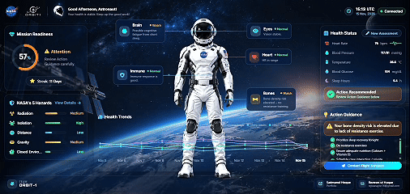

# ORBIT-1
## Interface Preview

<p align="center">
  
</p>

ORBIT-1 is a NASA-inspired astronaut health monitoring system designed for the
NASA Space Apps Challenge 2026. The application translates a daily astronaut
check-in into an actionable mission-readiness profile through a modern interface.

## Features

### Mission Control System

- Presents a centralized astronaut mission-control system.
- Provides in-context modal interfaces, allowing users to access detailed
  information without navigating across multiple pages.
- Provides a daily check-in workflow with automatic assessment prompting when no
  assessment has been submitted for the current day.
- Shows the latest mission-readiness state, assessment streak, and current
  operational status.

### Daily Health Assessment

- Captures sleep duration, resistance or bone-loading exercise, musculoskeletal
  discomfort, cognitive mood, isolation, and physical energy through a validated
  form workflow.
- Uses server-side request validation for all assessment dimensions and accepted
  enum values.
- Clearly indicates that the prototype accepts manual input and does not
  currently connect to embedded biometric sensors.
- Submits assessments asynchronously through the dashboard modal workflow.

### Readiness and Biometric Telemetry

- Calculates a bounded readiness score using sleep, exercise, musculoskeletal
  discomfort, mood, isolation, and energy impact rules.
- Classifies readiness as `All Readings Normal`, `Minor Attention Needed`, or
  `Action Recommended`.
- Provides body-system status indicators for the brain, heart, bones, eyes, and
  immune system.
- Generates prototype heart rate, blood pressure, body temperature, blood
  glucose, and sleep-duration telemetry after an assessment is processed.
- Displays contextual status descriptions and the primary alert associated with
  the latest assessment.

### NASA Human-Spaceflight Hazard Monitoring

- Monitors the five NASA human-spaceflight hazards: radiation, isolation and
  confinement, distance from Earth, gravity fields, and hostile or closed
  environments.
- Calculates hazard percentages and maps them to `Low`, `Medium`, or `High`
  operational levels.
- Provides a detailed hazard modal with explanatory content and an acknowledgement
  action.

### Trends and Operational Guidance

- Visualizes historical readiness score, sleep hours, heart rate, and
  temperature data with an ApexCharts line chart.
- Groups multiple assessments by date and displays the latest daily record for
  trend analysis.
- Displays personalized action guidance based on the astronaut's assessment
  signals.
- Recommends operational responses such as sleep recovery, resistance exercise,
  nutrition, symptom monitoring, and crew interaction.
- Provides a Flight Surgeon communication modal for escalating mission-health
  concerns.

### Interface and Data Experience

- Uses reusable Blade partials for dashboard sections, layouts, and modal
  workflows.
- Provides modal-based assessment, hazard detail, and Flight Surgeon
  communication flows without leaving the dashboard.
- Uses glassmorphism cards, neon status indicators, astronaut body hotspots,
  responsive layouts, and NASA-inspired HUD visual language.
- Persists assessment results and structured guidance data for subsequent
  dashboard views.
- Tracks the latest assessment, historical assessments, and completed assessment
  days.

## Technical Architecture

ORBIT-1 follows a layered Laravel architecture built around the Repository
Pattern and Service Layer Pattern. This separates HTTP concerns, business rules,
and data persistence so each component has a focused responsibility.

### Repository Pattern

The `HealthAssessmentRepository` encapsulates Eloquent queries for creating
assessments, retrieving the latest assessment, and loading historical trend data.
The controller and service layer depend on the `HealthAssessmentInterface`,
rather than directly coupling application logic to the persistence
implementation. This makes the data-access boundary explicit and keeps future
storage changes isolated.

### Service Layer Architecture

The `HealthAssessmentService` is the application-service boundary for the
assessment workflow. It coordinates readiness-score calculation, body-system
classification, simulated-vital generation, hazard classification, guidance
generation, streak calculation, and chart-data preparation. Controllers remain
thin orchestrators that delegate domain processing to the service.

### SOLID Design Principles

- **Single Responsibility Principle:** Controllers handle HTTP orchestration,
  form requests handle validation, services handle business rules, repositories
  handle persistence, and models represent stored assessment data.
- **Open/Closed Principle:** Assessment option sets are represented by dedicated
  enums, while scoring behavior is organized into focused impact methods that
  can be extended without rewriting the request or persistence layers.
- **Liskov Substitution Principle:** The service depends on the
  `HealthAssessmentInterface`, allowing a compatible repository implementation
  to be substituted without changing the service contract.
- **Interface Segregation Principle:** Persistence behavior is exposed through a
  focused health-assessment interface instead of requiring consumers to depend
  on unrelated data-access methods.
- **Dependency Inversion Principle:** Application services depend on the
  repository abstraction rather than constructing Eloquent queries throughout
  the presentation layer.

### Application Layers

- **HTTP layer:** `HomeController` exposes the dashboard, assessment, hazards,
  and Flight Surgeon workflows.
- **Validation layer:** `HealthAssesmentRequest` constrains incoming assessment
  values before processing.
- **Application layer:** `HealthAssessmentService` coordinates scoring,
  telemetry generation, hazard classification, and trend preparation.
- **Persistence layer:** `HealthAssessmentRepository` abstracts Eloquent
  queries for assessment creation, retrieval, and historical trends.
- **Domain model:** PHP backed enums provide the selectable assessment
  dimensions, while `HealthAssessment` casts structured guidance data.
- **Presentation layer:** Blade partials compose the dashboard from reusable
  sections and modal views.
- **Client layer:** Handles modal interactions, asynchronous form submission,
  notifications, and ApexCharts telemetry rendering.

## Requirements

- PHP `8.3+`
- Composer `2.x`
- Node.js `20+` and npm
- SQLite with PDO support

## Installation

Clone the repository and install the backend and frontend dependencies:

```bash
git clone https://github.com/sadmanulhoque/Orbit-1-NASA-Space-APP-Challenge-2027.git
cd Orbit-1-NASA-Space-APP-Challenge-2027

composer install
npm install
```

Create the local environment, generate the application key, and initialize the
SQLite database:

```bash
copy .env.example .env
php artisan key:generate
php artisan migrate
```

Build the production frontend bundle:

```bash
npm run build
```

Start the local development server:

```bash
php artisan serve
```

Open `http://127.0.0.1:8000` in a browser.

For iterative frontend development, run Vite in a second terminal:

```bash
npm run dev
```

## Quality Checks

Run the automated test suite:

```bash
php artisan test --compact
```

Format modified PHP files with Laravel Pint:

```bash
vendor/bin/pint --dirty --format agent
```

## Contributing

1. Create a feature branch.
2. Keep domain logic inside services and persistence logic inside repositories.
3. Add focused tests for behavior changes.
4. Run the quality checks before opening a pull request.
5. Describe user-facing and telemetry-model changes in the pull request.

## License

This project is distributed under the MIT License. See the repository license
configuration for details.

## Acknowledgements

ORBIT-1 is inspired by NASA's human spaceflight research and the operational
challenges astronauts face during long-duration missions. It is an independent
challenge project and is not an official NASA product.
